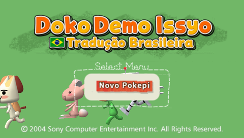
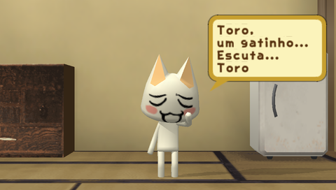
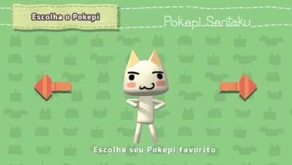
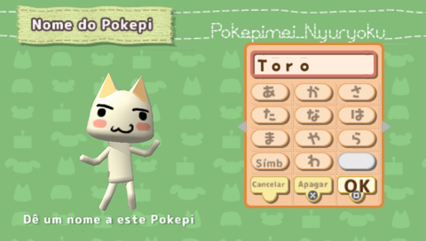
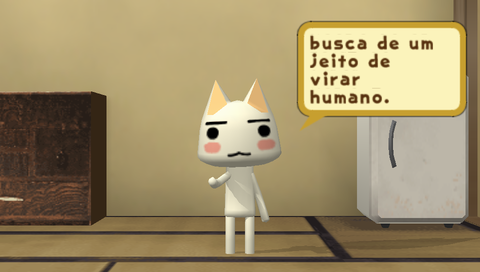
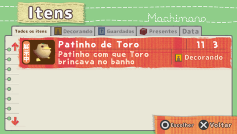
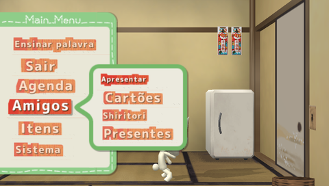
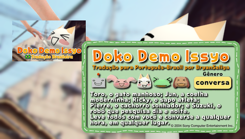

<p align="center"></p>

<p align="center">
  Brazilian Portuguese fan translation of <b>Doko Demo Issyo</b> (どこでもいっしょ) for PSP<br>
  <a href="../../releases/latest"><b>Download the latest patch</b></a>
</p>

<p align="center">
  
  
</p>

# Doko Demo Issyo — Tradução Brasileira (PSP)

Fan translation of **Doko Demo Issyo**, Toro's talking virtual pet game, into Brazilian Portuguese (PT-BR).

> This repository contains **only the patch** and the tools used to make it. No game files are distributed here. You need your own copy of the game.

## What is translated

- **Every line of all five Pokepi** (Toro, Pierre, Jun, Suzuki and Ricky), more than 52,000 texts, plus the words they already know.
- Menus, buttons and screen titles, redrawn with a rounded font close to the original look, with the striped menu highlights reshaped to the Portuguese words.
- A new title screen logo, and a new icon, name and description on the PSP home menu.
- System messages (saving, loading, errors, star signs, blood types).
- Item names and descriptions.
- The staff roles in the ending credits.
- The game font, extended with Portuguese accents (á à â ã é ê í ó ô õ ú ü ç).

Still in Japanese: the letters on the kana page of the keyboard (use the Latin page to teach words), the shiritori minigame (it depends on the Japanese language) and the staff names in the credits.

## Screenshots

<p align="center">
  
  
  
  
</p>

<p align="center">
  
  
</p>
<p align="center"><sub>Right: mock-up of the new icon and description over the game's PSP home menu background.</sub></p>

## What you need

- The Japanese ISO of the game: `Doko Demo Issho (Japan).iso`, product code **UCJS-10002**.
  - SHA-1: `d5561bfb9362a47357aa070d8665ea22fdc83084`
- The patch file (`.xdelta`) from the **Releases** page of this repository.
- A program that applies xdelta patches, for example:
  - [Delta Patcher](https://github.com/marco-calautti/DeltaPatcher) (Windows, Linux, Mac)
  - [Rom Patcher JS](https://www.marcrobledo.com/RomPatcher.js/) (in the browser)
  - or the Python patcher in this repository (see below)

## How to apply

1. Check that your ISO is the right one (SHA-1 above). A different ISO will not work.
2. Open the patching program and pick the original ISO and the `.xdelta` file.
3. Create the new ISO, for example `Doko Demo Issyo (PT-BR).iso`. The original is left untouched.
4. Optional: check the new ISO. Its SHA-1 is listed in the release notes.

Since v1.3 the patch carries a checksum for every block. If the download is corrupted or the original ISO is not the right one, Delta Patcher, xdelta and the Python patcher stop with an error instead of producing a broken ISO.

With Python 3 installed, you can also apply it from the command line:

```
python tools/vcdiff.py aplicar "Doko Demo Issho (Japan).iso" "Doko Demo Issyo PT-BR.xdelta" "Doko Demo Issyo (PT-BR).iso"
```

## Where to play

- **PPSSPP** (PC, Android, iOS): tested and working.
- **Real PSP**: needs custom firmware, because the patch uses the unencrypted executable. Being tested on a PSP-3000; please report any problem.

## Tips

- The Pokepi end their sentences with their own verbal tic, just like in the original: Toro says ", miau", Pierre ", au", Jun ", pyon", Suzuki ", robô" and Ricky ", croac" or ", sô" (originally "nya", "wan", "pyon", "robo", "kero" and "dasu").
- The keyboard opens on the Japanese page. To type with Latin letters (ABC, DEF…), move the cursor to the right edge of the keyboard and press → once more.
- If something looks cut off or wrong, please open an *issue* with a screenshot and, if you can, what was happening in the game.

## For contributors

- `tools/`: Python tools to read and rebuild the game files (KSC scripts, BP/BPM archives, XFT font, GIM images) and to build the patch.
- `traducao/`: the translated texts, one JSON object per line (`{"id", "pt"}`). The Japanese text is not stored in the repository; it is extracted from your own ISO with `tools/extract_text.py`.
- `art/`: the source images for the title logo, the PSP menu icon and the description box.
- `docs/FORMATOS.md`: how the game's file formats work (in Portuguese).
- `docs/GUIA_TRADUCAO.md`: the translation style guide (in Portuguese).

To build the translated ISO from your copy and create the patch:

```
cd tools
python make_iso.py "<original iso>" "<translated iso>"
python make_patch.py "<original iso>" "<translated iso>" "Doko Demo Issyo PT-BR.xdelta"
```

`make_patch.py` checks the result by applying the patch back.

## Credits

- Translation, tools and art: [BryanSeliga](https://github.com/BryanSeliga).

## Disclaimer

Non-commercial fan project, not affiliated with Sony or BeXide. *Doko Demo Issyo* and its characters belong to their respective owners. Please buy the original game.
